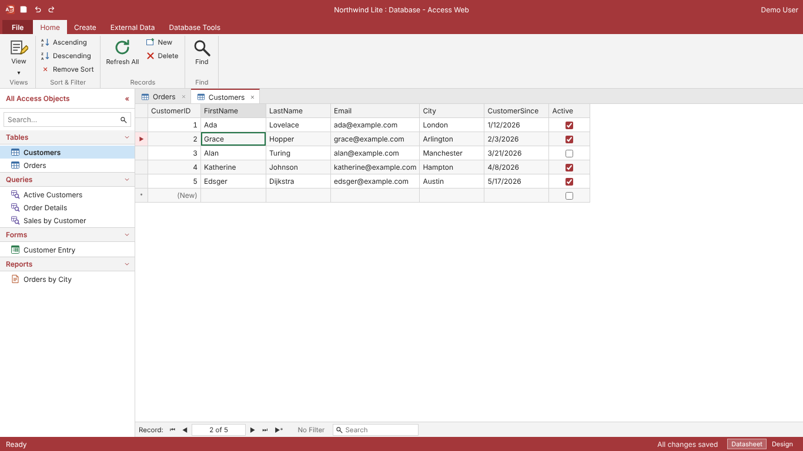

# Access Web

A browser-based look-alike of Microsoft Access. People register, build databases (tables, queries,
forms, reports, relationships), and everything saves to their account. Any database can be
downloaded as a real Microsoft Access **.accdb** file.



## What's in it

| Access feature | Here |
| --- | --- |
| Backstage / start screen | Templates (Blank, Contacts & Orders), My databases and Shared with me, rename, delete |
| Pictures | **Image** data type: pictures (PNG, JPEG, GIF, WebP; big photos shrunk to 2400 px) stored on the server apart from the database, shown as thumbnails in datasheets (taller rows via Row Height) and query results, in an **Image** form control and in reports. Double-click a cell to view, replace, remove or download; drop an image file on a cell or paste one with Ctrl+V. Pictures are copied with Save a copy and when pasting or importing tables from another database, shown to public viewers of a published database, and removed a day after nothing uses them. Per-database limit `IMAGE_QUOTA_MB` (default 200). Not yet written to .accdb exports |
| Export Schema | File → **Export Schema**: pick tables and download (or copy) their design as SQL for MySQL/MariaDB, SQLite or Access, as a Markdown document, or as JSON: fields, data types, primary keys, indexes, defaults, and relationships between the chosen tables as foreign keys |
| Sharing | Share with registered users by email as **Can view** or **Can edit**, or let anyone with an account who has the link view or edit, or **publish** it so anyone with the link can view it without an account (no export or copy). Viewers can run queries, export, and **Save a copy**; other people's saves appear automatically within seconds |
| Ribbon | File, Home, Create, External Data, Database Tools, plus contextual *Table Design* / *Query Design* tabs |
| Navigation Pane | All Access Objects grouped by type, search, double-click to open, right-click Open / Design View / Copy / Paste / Rename / Delete, **F2 renames in place**, F11 to collapse |
| Copy & paste | **Ctrl+C / Ctrl+V** (or Home → Paste) copies tables, queries, forms and reports, within a database or into another one you open. Tables paste as *Structure Only*, *Structure and Data* or *Append Data to Existing Table*; pasted forms and reports reconnect to their record source by name |
| Tables — Datasheet View | Inline editing, keyboard navigation like a spreadsheet: Enter or ↓ saves and goes to the next row (Shift+Enter or ↑ goes up), ← → save and move sideways after typing into a cell (after F2 or a double-click they move within the text), Tab to the next field, Esc cancels, new-record row with `*`, record navigator, search filter, sort, multi-row delete, column widths (drag an edge, double-click to fit) saved with the table or query |
| Tables — Design View | Field Name / Data Type / Description grid, Field Properties pane (Field Size, Default Value, Required, Indexed), Primary Key (one field, or several for a combination key), **Indexes** (fields unique together, e.g. PetType + Breed, checked as you type and in action queries), Insert/Delete Rows, drag row selectors to reorder fields (several at once when selected), safe type conversion. **Lookup** tab and **Lookup Wizard** (also in the Data Type list): a Short Text or Number field picks its value from a table, query or typed list (Display Control, Row Source, Bound Column, Display Column, Limit To List), optionally creating the relationship. Lookup fields show the display value with a drop-down (▾, F4 or Alt+↓, type to filter) in table and query datasheets, and become combo boxes on forms |
| Data types | AutoNumber, Short Text, Long Text, Number (Byte/Integer/Long/Single/Double), Currency, Date/Time, Yes/No |
| Validation | Types, field sizes, primary keys, *No Duplicates* indexes, required-field reminders, referential integrity |
| Queries | **Select, Make Table, Append, Update, Delete and Crosstab** queries, chosen on the Query Design tab, each with Access's extra grid rows (Total, Crosstab, Append To, Update To, Delete). **Totals (Σ)** adds Group By, Sum, Avg, Min, Max, Count, StDev, Var, First, Last and Where. Design grid: Show Table (any time, to add more tables), double-click a field to add it (tap on touch screens), automatic joins from relationships drawn as join lines (1 and ∞ when enforced), drag a table's title bar to move it or its edges to resize it, drag the bar above the grid to resize the grid (the layout is saved with the query), select a column by its grey bar to drag, resize, Ctrl+←/→ or Delete it. SQL View for any of these, including SQL typed by hand or imported from Access. **Select queries written in SQL open in Design View**: tables and saved queries, INNER/LEFT/RIGHT joins (drawn with arrows; double-click a line for Join Properties, drag a field onto another to join), Alias: expressions, Criteria and **or:** rows, totals (Group By, Sum, Count(*), Expression, Where), HAVING, ORDER BY and DISTINCT (Unique Values). Design View checks that the rebuilt query returns the same records before showing it; UNION, subqueries, TOP, DISTINCTROW and PARAMETERS stay in SQL View for now. Datasheet View previews what an action query will change; **Run** applies it after a confirmation (Ctrl+Z undoes it), skipping and reporting records that would break keys, required fields or relationships, like Access. Select query results are **editable** when Access would allow it; drag a record selector's bottom edge or use **Row Height** (Home tab) to set the row height, which is saved with the query (tall rows wrap text) |
| Forms | **Form designer**: drag controls (label, text box, combo box, list box, check box or switch, button, image, subform, tab control, rectangle, line) from the toolbox or fields from the field list onto the header, detail or footer; move, resize, align, size and layer them with snap-to-grid; edit everything in the Property Sheet (control source, label position, fonts, colours, borders, rounded corners, combo/list row sources from a value list, table or query, button actions such as next record, new, save, delete, open form/report, close). Seven themes (Office, Modern, Slate, Ocean, Forest, Sunset, Midnight), Stacked or Two Columns auto-layout, copy/paste/duplicate controls, every change undoable. **Default View** (Property Sheet): **Single Form** (one record at a time), **Continuous Forms** (the detail section repeated for each record, the header and footer once; click into a record to make it current, with a new-record row at the end), **Datasheet** (the form's fields as columns) or **Split Form** (one record above a datasheet). Enter moves to the next field; edits write back to the table, and **forms based on queries can be edited** too: each field saves to the table it comes from, and a query on one table can add and delete records; on phones the controls stack in one column. **Find records (Filter by Form)**: 🔍 Find in the record bar or Home → Filter by Form turns the form's fields into boxes to type what you're looking for (text finds anything containing it; `=Smith` exact, `S*`, `>100`, `1/1/2026...3/31/2026`, `=` empty, Any/Yes/No for check boxes, lookups by the name shown); **Or** tabs for alternatives; Enter finds, Esc cancels; Toggle Filter or the Filtered button switches between found and all records; Ascending/Descending sort by the field you're in. **Calculated controls and the Expression Builder**: a text box's Control Source can be an expression such as `=[FirstName] & " " & [LastName]`; type it, or click **…** for the Expression Builder (Access's Elements / Categories / Values lists of fields, controls, ~70 functions, constants, operators and common expressions; functions insert with «placeholders» you Tab through; a live result for the first record and plain-language errors). Supports IIf, Nz, Format, DateDiff/DateAdd, text and math functions, Sum/Avg/Count(*) over the form's records (for headers and footers), and DLookup/DCount/DSum on tables; a Format property (Currency, Percent, Short Date, `0.00`…) sets how the result shows. **Tab order**: Form Design → Tab Order lists each section's controls in the order Tab and Enter visit them; drag them (or use Up/Down, Alt+↑/↓), Auto Order for top-to-bottom, and untick Tab stop for controls to skip, with the numbers shown on the form; the Property Sheet also has Tab Stop and Tab Index. **Subforms (related records)**: the field list's *Related records* (or the Subform tool) puts a related table's records inside the form, e.g. each customer's orders, as an editable datasheet; or the **Source Object can be another form**, shown in its own Default View (a continuous list of order lines, a datasheet…) with only the records linked to the main form's record; Link Master/Child Fields come from the relationship, and new rows get the link filled in. The main form can show values from its subform, such as `=[Tasks subform]![SumOfCost]`. **Tab controls**: pages with their own controls (Property Sheet → Pages, one caption per line); controls dropped on a tab control go on the page it shows, and moving the tab control moves its pages' controls. **Drop-down calendar** on Date/Time boxes in forms and datasheets (the calendar button, Alt+↓ or F4; arrows, Page Up/Down, Enter; Today and Clear) |
| Reports | **Report Design View** like Access's: Report Header, Page Header, a header and footer for each group, Detail, Page Footer and Report Footer, each resizable with its own Back Color, Force New Page, Keep Together and Visible (click a section's bar). Labels, text boxes (fields or expressions such as `=Sum([Cost])`, `=Count(*)`, `="Page " & [Page] & " of " & [Pages]`, `=Now()`), check boxes, pictures, rectangles and lines: drag from the toolbox or field list, move, resize, align, size and order them, and format them in the Property Sheet (font size, bold, italic, alignment, fore/back/border colors, border width, Format, Hide Duplicates, Visible). **Page Setup**: Letter, Legal, Tabloid, A4, A5 or a custom size, portrait or landscape, and margins, with a guide showing where the paper's printable width ends. **Group, Sort, and Total**: up to 10 group levels (A→Z or Z→A, header, footer, keep together) plus sorts; totals in a group footer add up that group, in the report footer the whole report. Report Design ribbon: Group & Sort, Title, Page Numbers, Date and Time, Page Setup. Report View shows real pages at the paper size and Print prints exactly them. New reports start from a Report Wizard layout (title, date, column headings, records, group and grand totals, page numbers). Imported Access reports keep their design: sections, controls, colors, fonts, grouping and sorting, margins and paper size. **Public report links**: the owner can make any report (or labels) public with 🔗 Make public… (or the report's right-click menu); anyone with the link sees it at /r/… without signing in. The link serves a copy of only the columns and records the report shows, never the database, and the copy updates itself when the data changes while an owner or editor has the database open. Turning it off kills the link. Labels' QR codes can open a public report (no sign-in) with the scanned person highlighted. **Scan Tags** (Home): a scan station that reads name tags' QR codes with the phone camera (or a typed ID / USB barcode scanner) and runs a saved scan action: add a record (e.g. Attendance: person, time, "Session 2"; "Make one for me" builds the table and relationship) or set a field on the person (e.g. CPR = Yes), optionally only once per person, with big ✓/✗ feedback, a beep, and Undo. **Recording from a tag's public page**: each scan action has a *Who can record* list of emails (plus the owner and editors). When one of those people scans a tag with their phone camera and is signed in, the public page shows that person's actions (e.g. ☐ Take attendance); ticking one records it on the server, with the phone's date and time. Signed-out visitors see only the public report (and a "Staff: sign in" link); nothing can be recorded without signing in. **Report QR codes**: any report can print a page QR code (Design View → QR code) that opens the report's public link, the report in the app, or another web address, with an adjustable size, corner and caption; labels' QR codes can sit beside, above or below the text, or in any corner. **Labels and name tags** (Create → Labels): one label per record at real size on Letter or A4 sheets, with Avery presets (5395 name badges, 5392, 5390, 5164, 5163, 5160) or your own width, height, margins, gaps and labels across/down; lines of text with `[Field]` placeholders, size, bold and italic; skip labels used on a partly used sheet; live preview in Design View. Optional **QR code** on each label that opens that person's record in a form or table when scanned (whoever scans signs in and needs access to the database, or it must be published). Set "Web address phones use" to your hosted address so phones can reach it. In the print dialog choose Margins: None and Scale: 100% |
| Macros | **Macro Builder** like Access 2010 and later: a list of actions with their arguments, **If / Else If / Else** blocks, comments, groups and submacros, reordered with ▲ ▼. Buttons and other controls run macros from **On Click**, **On Dbl Click**, **After Update**, **On Got Focus** and **On Lost Focus**, forms from **On Load**, **On Current** and **On Close** (Property Sheet → Event → **…**). **Named macros** (Create → Macro) appear in the Navigation Pane under Macros, run when opened (or with ▶ Run), and one named **AutoExec** runs when the database opens. About 35 actions, the core `DoCmd` ones first: OpenForm and OpenReport (with a **Where Condition** that shows only matching records, Data Mode Add / Edit / Read Only), OpenTable, OpenQuery (runs action queries), CloseWindow, GoToRecord, GoToControl, FindRecord, ApplyFilter / ShowAllRecords, Requery, SaveRecord, DeleteRecord, **RunSQL** (asks first, like Access, unless **SetWarnings** No), SetValue, SetProperty (Visible, Enabled, Locked, Caption, colors, Value), MessageBox, Beep, SetTempVar / RemoveTempVar (read anywhere as `[TempVars]![Name]`), SetLocalVar, RunMacro (with Repeat Count / Expression), RunMenuCommand (SaveRecord, DeleteRecord, RecordsGoToNew, Undo, Refresh…), OnError (Next / Macro Name / Fail), StopMacro, StopAllMacros, PrintOut and QuitAccess. Arguments starting with `=` are expressions; expressions can use `[Forms]![Form]![Control]`, `[TempVars]![x]`, the **domain functions** (`DLookup`, `DCount`, `DSum`, `DAvg`, `DMin`, `DMax`, `DFirst`, `DLast`) and `MsgBox("Delete it?", 4) = 6` in a condition, which asks Yes / No first. A failed action shows why and stops the macro, as in Access |
| Relationships | Draggable table boxes, drag a field onto another to relate, Enforce Referential Integrity with Cascade Update Related Fields and Cascade Delete Related Records (following chains of related tables; also in action queries and schema export), 1–∞ lines |
| Other databases | External Data → **Import Objects** / **Link Objects**: pick one of your databases or one shared with you, then its tables and queries. *Import* copies them (definition and data, or definition only, plus relationships between them), renaming anything whose name is taken and updating imported queries to match. *Link* shows the source's current data read-only, for tables and select queries; links work in local queries too, and stop working (with a clear message) if the source is unshared or deleted |
| MySQL / MariaDB | External Data → **Connections**: server address (or a `mysql://` URL), port, database, user name, password and SSL, with **Test Connection**. **Test Connection** lists the server's databases to pick from. After saving, choose **Link Tables** (or **Link Tables…** in the Connections list) to see the database's tables; linked tables appear in the Navigation Pane and in Query Design's **Show Table**. Linked tables keep their **foreign keys**, so Query Design joins them automatically and the Relationships window shows them (dashed, read-only). **Link Tables** to browse remote tables (read-only, 500 records a page) and use them in local queries alongside your own tables; **Import Tables** copies tables, keys, indexes and foreign-key relationships with their data; **SQL Console** runs one statement at a time and shows `mysql`-client output (`Query OK…`, `ERROR 1146 (42S02)…`) plus a datasheet for SELECT results |
| External Data | **Import Access databases** (.accdb/.mdb), import CSV/text into a new table (type detection), export a table/query to CSV, **export the database to .accdb** |
| Phones & tablets | Detected automatically (screen size, touch input, and the browser's mobile hint). **Phones** get a phone layout: the ribbon collapses to its tab row and drops down when you tap a tab, the Navigation Pane becomes a slide-out drawer (☰), dialogs and menus fill the screen. **Forms designed for a desktop (imported Access forms too) rearrange themselves for phones**: one column with each label above its box (a check box's beside it), titles at a readable size, a button's picture inside the button, the header's buttons as a row that scrolls sideways, a search box kept on one line with its Go/Clear buttons (Access's invisible buttons over icons become icon buttons), lines and boxes left out. **List forms** (continuous, datasheet and split) become a list of **cards** with a search box and + New: each card shows the record's first few fields (lookups by name, column headings dropped), and tapping one shows the record, with a List / Record switch. Per form, Property Sheet → **Phone Layout** can instead keep the design shrunk to fit; per control, **Show on Phones** leaves it out of the phone layout. On **tablets** a form wider than the screen shrinks to fit its width. **Full screen** (⤢ in the status bar, for an open form or report): the form on its own, like an app, without the ribbon, Navigation Pane, tabs and status bar (only errors show). A slim bar has ‹ Back (closes it and shows the one opened before), the caption, and ☰ with the database's forms (not ones used only as subforms), **Copy a link to this form** and Exit. The address bar holds `?db=…&open=form:…&full=1`, so reloading keeps it and the link opens that form full screen: send it to staff, or add it to a phone's home screen, where it opens without the browser's bars. Full screen is a convenience, not a lock: whoever has the database open can still leave it, and what they may change is set by sharing. **Touch screens** (phones and tablets) get taller rows, tap to open objects, tap a selected cell again to edit it, long-press for the object menu, tap-a-field-then-another to relate tables, and ◀ ✕ ▶ buttons to move query columns. File → **Layout** (or the start page) switches between Automatic, Phone and Desktop |
| Keyboard | Ctrl+; enters today's date and Ctrl+Shift+; the time (in Date/Time and text fields), double-click a combo box to cycle its choices, Ctrl+Z / Ctrl+Y undo and redo, Ctrl+S saves (it also autosaves) |

Queries accept Access SQL: `[Bracketed names]`, `"text"`, `#12/31/2026#` dates, `&` concatenation,
`Like "A*"` wildcards, `Yes`/`No`, and functions such as `IIf`, `Nz`, `Left`, `Right`, `Mid`, `Len`,
`UCase`, `LCase`, `Year`, `Month`, `Day`, `Now`, `Date`, `CStr`, `CInt`, `CDbl`, `Val`, `IsNull` (and the rest of
the expression functions), `SELECT DISTINCTROW`, `Table!Field`, and references Access fills in before running the
query: `[Forms]![Orders]![ID]`, `Form![ID]` and `[Application].[CurrentObjectName]` in a combo box's row source,
`[TempVars]![x]` (Null when the form isn't open). `MSysObjects` lists the database's tables, queries, forms
(Type -32768), reports (-32764) and macros, for "choose a report" lists. In calculated controls, `DLookup`,
`DCount` and the other domain functions work over saved queries as well as tables.

## Why this stack

The brief was "the most supportable code base", so every choice is a mainstream default with a
large hiring pool and long-term support:

- **TypeScript everywhere** for the app — **React 19 + Vite** in the browser, **Node.js 22 LTS + Express 5** on the
  server — so one team in one language owns the UI, the API and the shared data model (`shared/model.ts`, validated
  with **Zod** on both sides).
- **SQLite** (via `better-sqlite3`) stores users, sessions and projects. One file, zero administration, easy backups.
  `server/src/db.ts` is the only place that touches it, so moving to PostgreSQL later is a contained change.
- **SQLite compiled to WebAssembly** (`sql.js`) runs each user's queries **in their browser**. Untrusted SQL never
  executes on the server.
- **Jackcess (Java)** writes the `.accdb` file. It is the only mature, open-source library that can *create* Access
  databases; nothing comparable exists for Node, Python or .NET on Linux. It is isolated in a ~250-line command-line
  program (`exporter/`) that the server runs per export — no Java framework, no shared state.

## Running it

**Step-by-step guides:** [run it on your own PC](docs/INSTALL-LOCAL.md) (Windows, macOS, Linux desktop: a
local web server you open in your browser, no internet needed) and
[install it on a Linux server](docs/INSTALL-LINUX.md) (systemd service, nginx + HTTPS, backups).

### Docker (recommended)

```bash
docker compose up --build
# open http://localhost:3000
```

Data lives in the `access-web-data` volume (`/data/access-web.db`). Back it up by copying that file
(SQLite's `.backup` command is safest while running).

### Render.com

The repository includes a Render Blueprint (`render.yaml`). In Render: **New → Blueprint**, connect this GitHub
repository, and click **Apply**. Render builds the Dockerfile, attaches a 1 GB persistent disk at `/data` for the
SQLite database, serves the site over HTTPS, and redeploys on every push to the default branch.

A persistent disk needs a paid instance; on the free instance type the database would be erased on each deploy.
The disk also limits the service to one instance and means each deploy has a few seconds of downtime.

### Local development

Requires Node.js 22+, Java 21+ and Maven 3.9+.

```bash
npm install
npm run build:exporter     # builds exporter/target/access-exporter.jar
npm run dev                # API on :3001, web app with hot reload on http://localhost:5173
```

Production build without Docker:

```bash
npm run build && npm run build:exporter
NODE_ENV=production SECURE_COOKIES=false PORT=3000 npm start
```

### Configuration

| Variable | Default | Purpose |
| --- | --- | --- |
| `PORT` | `3001` (`3000` in Docker) | HTTP port |
| `DATA_DIR` | `./data` | Where `access-web.db` is stored |
| `SECURE_COOKIES` | `true` when `NODE_ENV=production` | Mark the session cookie Secure and add `upgrade-insecure-requests`. Set `false` only if you're not using HTTPS. |
| `TRUST_PROXY` | `false` | Set `true` behind a reverse proxy so client IPs (used for login rate limiting) are correct |
| `JAVA_BIN` | `java` | Java executable used for exports |
| `EXPORTER_JAR` | `exporter/target/access-exporter.jar` | Path to the exporter |
| `EXPORT_TIMEOUT_MS` | `60000` | Per-export time limit |
| `EXPORT_CONCURRENCY` | `2` | Exports that may run at once |
| `EXPORT_MAX_HEAP` | `512m` | Java heap per export; use `256m` on a 512 MB machine |
| `HOST` | all interfaces | Address to listen on; `127.0.0.1` accepts connections from this computer only (the local launchers and the Linux guide use it) |
| `STATIC_DIR` | `web/dist` | Built web app to serve |
| `CONNECTION_SECRET` | key file in `DATA_DIR` | Key that encrypts saved MySQL passwords (AES-256-GCM). If unset, a random key is created in `DATA_DIR/connection.key`. Changing it makes saved passwords unreadable (re-enter them) |
| `IMAGE_QUOTA_MB` | `200` | Total size of pictures (Image fields) each database may store, in MB |
| `ADMIN_EMAILS` | first account registered | Comma-separated emails that can open the **Site admin** page (`/admin`). Set it on a public server so admin access doesn't depend on who signed up first |
| `ACTIVITY_LOG_DAYS` | `90` | How long the admin page's activity log keeps entries |
| `CONTACT_EMAIL` | none | Shown in the Usage Policy as who to contact about it or to report misuse |
| `STRIPE_SECRET_KEY` | none | Stripe secret key (`sk_test_…` to try it) so people can subscribe to the Advanced plan. Without it, only the admin can turn advanced features on |
| `STRIPE_PRICE_ID` | a $0 / month price | The Advanced plan's Stripe price. If unset, a $0 monthly price is created in Stripe at the first upgrade |
| `STRIPE_WEBHOOK_SECRET` | none | Signing secret of a Stripe webhook to `/api/billing/webhook` (events `checkout.session.completed`, `customer.subscription.*`), so cancellations and failed payments are noticed |
| `ALLOW_PRIVATE_DB_HOSTS` | `false` | Allow MySQL connections to private/internal addresses (localhost, 10.x, 192.168.x, cloud metadata). Leave off on a public server |

## Exporting to Access

**External Data → Access** (or **File → Export to Access**) downloads `<database>.accdb` in the Access 2016
format, which opens in Access 2007 and later.

Included: every table with its fields, data types, field sizes, descriptions, default values, Required, primary keys,
indexes, AutoNumber values (IDs are preserved), all data, and relationships including Enforce Referential Integrity.

Not included, because no open library can write them: saved query objects, forms and reports. Instead,
every saved query's SQL is written to a table named **`_SavedQueries`** — paste each into a new query in
Access's SQL View to recreate it. (The SQL you write here is Access SQL, so it usually works unchanged.)

Two safety nets keep exports from failing: a field marked *Required* that still has blank values is exported
without the Required flag, and a relationship whose data doesn't satisfy integrity is exported without
enforcement.

## Importing from Access

**Open Access database** on the home screen creates a new database from an `.accdb` or `.mdb` file (Access 97
and later). **External Data → Access** inside a database adds another file's tables, queries, forms and reports to it, renaming
anything whose name is already taken (Customers → Customers1). Imports can be undone with Ctrl+Z.

Imported: tables, data, field types and sizes, descriptions, default values, Required, primary keys, single-field
indexes, AutoNumber values, single-field relationships with referential integrity, **lookup fields** (the Lookup
tab: combo or list box, a value list or a table / query with its bound and displayed columns, Limit To List, so a
contact ID shows the contact's name in datasheets), and saved queries' SQL. Select
and union queries run as-is; action queries (append, update, delete, make-table) and crosstabs come across as SQL
you can read but not run yet. A database exported from this app round-trips completely, including its queries.

**Calculated fields** become a saved query named *<Table> with Calculated Fields* that returns every field of the
table plus each calculated field as an expression (one calculated field may use another). Use it in forms, reports
and other queries where you used the calculated fields. Its results are editable, and the calculated columns update
as soon as you change a field they use.

**Forms** come across as designed forms you can open and edit in Design View: every control in place (Access's twips
become pixels), with its Control Source (fields and calculated `=…` expressions), captions, fonts, colors, borders,
Format, Visible, Locked and Tab Stop, header/detail/footer heights and colors, the tab order, Navigation Buttons,
Allow Edits/Additions/Deletions and the Default View (single, continuous, datasheet or split). Text boxes, labels, combo and list boxes (value lists, or tables/queries with their
bound and displayed columns), check boxes (and option and toggle buttons), command buttons, subforms (the form they show, in its own view, linked on
Link Master/Child Fields), rectangles, lines and bound pictures are supported. A record source or list that's a
SQL statement becomes a saved query. **Unbound forms** (menus, switchboards, dialogs) come across without a
record source. **Tab controls** keep their pages (each page's controls show when its tab is picked). **Pictures in
the design** (logos, from the control itself or the database's shared images) come across, converted to PNG when
Access stored them as a bitmap or metafile. Pictures pasted in as OLE objects (Paint) come across too. **PivotChart** forms (Access 2010 and earlier) become **charts** of their records: column, bar, line, area or pie, grouped by the chart's category with each series totalled (Sum, Count, Avg, Min, Max) and its title; a series Access drew against a second value axis gets its own panel instead of a second scale. Hover or tap for values, **Show data** for a table. PivotTable forms show as datasheets. Unbound boxes keep their **Default Value** (Date() → today), and **Link Master Fields** can name such a box (a Date box above a subform). Access **Rich Text** shows as its words (formatting isn't shown yet). On **reports**, a combo box bound to a lookup shows the name from its
list (Checked Out To → Ann Lee), as in Access. Option group frames, charts and OLE/ActiveX controls are left out.

**Attachment fields** come across as Image fields with each record's first picture (Access databases use them
mostly for photos); other files in them are counted in the notes. **Multiple-value fields** come across as text,
their values separated by "; ".

**Macros and VBA** come across as macros. Named macros (AutoExec too, with their **submacros**, such as the
templates' Filters.QuickSearch) and embedded macros (a button's On Click
`[Embedded Macro]`, a form's On Load…) are copied as they are. **VBA event procedures** are translated line by line
into macro steps: `DoCmd.OpenForm`, `OpenReport` (with their Where Conditions), `Close`, `GoToRecord`, `GoToControl`,
`RunSQL`, `SetWarnings`, `RunCommand`, `ApplyFilter`, `Requery`, `OpenQuery`; `MsgBox` (also `If MsgBox(…) = vbYes`);
`Me.Requery`, `Me.Dirty = False`, `Me.Filter` / `Me.FilterOn`; setting a control's value or its Visible, Enabled,
Locked or Caption; `TempVars`; `Dim`'d variables (local variables) and module variables (temporary variables); `If /
ElseIf / Else` and `Select Case` blocks; `With Me`; `CurrentDb.Execute` (as RunSQL without asking); `Me.NewRecord`;
`Const` and `Enum` values from any module; numbered lines; calls to other procedures of the form's module and of standard
modules (also from event properties such as `=OpenOrder([OrderID])`), with their arguments, a form passed as `Me`, and
their `Exit Sub` kept inside them; and expressions with `Me.X` → `[X]`,
`Forms!F!C` → `[Forms]![F]![C]`, VBA constants, and the domain functions. Plain buttons (next record, new, save,
open a form…) get the built-in button action instead. What can't be translated (recordsets, loops, file commands,
functions from standard modules…) is kept as a comment in the macro and counted in the import notes; an `If` whose
condition can't be translated stops the macro when reached rather than running its steps unchecked. Events this app
doesn't run yet (Before Update, On Key Down, On Timer…) are listed in the notes.

Forms opened as **dialogs** (`OpenForm` with Window Mode Dialog) make the macro wait until they're closed, as in the
templates' New Contact button, and **OpenArgs** reaches the opened form. A form opened with a Where Condition that
matches nothing (`1=0`) starts on a new record. Other actions: `SearchForRecord`, `FollowHyperlink` (web pages, maps,
e-mail and phone links only), `EMailDatabaseObject` (opens a new e-mail to the address), Save As Outlook Contact (a
contact card, `.vcf`, that Outlook and phones open), Create Mailing Labels (the label maker), and Edit Picture.

**Reports** come across as designed reports you can edit in Report Design View: every section (report, page and
group headers and footers, detail) with its height, back color and Force New Page; labels, text boxes (fields and
expressions such as `=Sum(...)`, `=Now()` and page numbers), check boxes, rectangles, lines and bound pictures with
their fonts, colors, borders and Format; every group level of Sorting and Grouping (with its header, footer and sort
order); and the page's margins, paper size and orientation. Subreports, charts and pictures pasted into the design
are left out.

Form and report designs are read with [jetdb](https://github.com/dominion525/jetdb) (MIT/Apache-2.0), which decodes
the format Access stores them in (`MSysAccessStorage`). Access 2000 and later files are supported.

Not imported (each one is listed in the notes shown after the import): standard modules (VBA outside forms' event procedures), linked tables (their
data lives in another file; they're skipped with that file's path), and OLE Object fields. Password-protected databases need the
password removed first (Access: File → Info → Decrypt Database). Uploads are limited to 100 MB and about
200,000 records.

## Sharing

The owner clicks **Share** (title bar, or File → Share) to add people by the email they registered with, as **Can view**
or **Can edit**, and to set general access: *Restricted*, or *Anyone with an account who has the link* can view or edit.
Shared databases appear under **Shared with me**. Only the owner can share, rename or delete; editors can change
everything inside the database; viewers see it read-only and can run queries, export it, or **Save a copy** of their own.
Removing a shared database from your list doesn't affect anyone else.

**Public viewing.** Ticking *Public: anyone on the internet with the link can view* lets people open the database's link
without an account (`GET /api/public/:id`). Public viewers browse tables and run queries, forms and reports, read-only.
Exporting (.accdb and text), copying objects, **Save a copy**, and importing or linking from it into another database are
turned off, and the server refuses those requests for anyone who only has public access. MySQL connection details and
linked tables aren't available to them. Anything shown on screen can still be copied by hand, so don't publish data you
wouldn't put on a public web page. Unticking it stops the link working for people without access straight away.

Several people can have a database open at once. Each workspace checks every few seconds for other people's saves and
loads them automatically when it has no unsaved changes of its own. If two people change it at the same moment, the
second save is refused with the other person's name and a **Reload latest** button — there's no live merging of
simultaneous edits yet.

## Site admin page

Admins (see `ADMIN_EMAILS`) get a **Site admin** button on the Home page, which opens `/admin`:

- **Overview**: how many people have registered and are active (today, 7 and 30 days), databases and storage, sharing, server errors and failed sign-ins in the last 24 hours, and 30-day charts of sign-ups and active people.
- **People**: every account with when they joined and were last active, how many databases they own or have shared with them, storage and recent activity. Open someone to see their databases (name, tables, record count, size, how they're shared) and their activity.
- **Activity**: a searchable, filterable log of sign-ins (and failed ones), databases created, opened, saved, renamed, copied, exported, deleted and shared, public links and views, name-tag recordings, MySQL use and server errors, with IP addresses. Repeats within 10 minutes fold into one line ("Saved changes ×12"). Download it as CSV.

The log records actions, database names and sizes, never what's in anyone's tables. Non-admins get "not found" from the admin API.

## Usage Policy

Everyone agrees to the **Usage Policy** (`/policy`, text in `shared/policy.ts`) when they create an account: their data is theirs and is never sold, what the site records, what isn't allowed, and that misuse gets an account banned. Which version each person agreed to, and when, is stored. People who registered earlier, or before a new version, are asked to agree at their next visit; until they do, the app's API refuses their requests. To publish a new version, edit the text and change `POLICY_VERSION`.

Admins can **suspend** an account from its page in Site admin, giving a reason. It's signed out everywhere and can't sign in, and its databases close to the people it shared them with and to public links (public databases and public reports). Nothing is deleted, and **Reinstate account** puts everything back. Both are recorded in the activity log.

## Plans and advanced features

Four features can be reserved for the **Advanced** plan: **Sharing**, **Public links** (public databases, public reports, name-tag QR codes), **MySQL connections** and **Access files** (.accdb import and download). Nothing is reserved until an admin turns on **Require a plan** in Site admin → **Plans**, where they also choose which features count as advanced.

- People get advanced features by subscribing (Stripe Checkout; **Your plan** on the Home page), or by an admin turning features on for them: tick people in the Plans tab, choose features, **Turn on** / **Turn off**, or click a person's On/Off. Admins always have everything.
- A feature belongs to a database's owner: editors of an Advanced owner's database can share it.
- Using an advanced feature without it gets a friendly "upgrade" answer (HTTP 402), and the app shows the plans with that feature highlighted. Things already set up keep working (existing shares, public links, linked MySQL tables); only setting up new ones is refused.
- **Trying Stripe at no cost:** set `STRIPE_SECRET_KEY` to a test key. The first Upgrade creates a $0 / month price, Checkout needs no card, and the plan is confirmed when the person returns (even before a webhook is set up). Manage billing opens Stripe's customer portal (in test mode, save its settings once in Stripe first). Plan changes and admin grants are in the activity log.

## Security notes

- Passwords are hashed with scrypt (Node's built-in `crypto`); sessions are random 256-bit tokens stored as SHA-256
  hashes, in an `HttpOnly`, `SameSite=Lax` cookie that lasts 30 days.
- Every request checks the signed-in user's role on that database (owner, editor, viewer); databases you can't see
  return 404, so ids can't be probed. Only owners can share, rename or delete.
- CSRF: state-changing requests must be JSON or carry `X-Requested-With`, which cross-site forms can't send.
- Login and registration are rate-limited per IP; Helmet sets a strict Content Security Policy.
- Saves use optimistic concurrency (`revision`), so two open windows can't silently overwrite each other — the
  second one is told to reload.
- Users' SQL runs only in their own browser, against their own data.
- MySQL connections belong to a database. Passwords are encrypted at rest and never sent back to the browser; editors
  can use a connection (link, import, SQL Console), viewers can only browse linked tables. The SQL Console runs with
  the privileges of the MySQL account you saved, so give that account only the rights people should have.
- The server refuses MySQL connections to private and internal addresses unless `ALLOW_PRIVATE_DB_HOSTS=true`, so a
  public deployment can't be used to probe its own network. Your MySQL server must accept connections from the
  internet (ideally with SSL set to *Required* or *Verify*).

## Project layout

```
shared/        Data model + Zod schemas and templates, used by both server and web
server/        Express API: auth, projects, export (TypeScript)
  src/db.ts        SQLite connection and migrations
  src/auth.ts      Registration, login, sessions
  src/projects.ts  Project CRUD and the .accdb download
  src/export.ts    Converts a project to the exporter's JSON and runs Java
  src/accessImport.ts  Runs the Java tool in --import mode and converts the result (shared/exchange.ts)
  src/accessForms.ts   Forms, reports and their events from the Access file (jetdb)
  src/accessMacros.ts  Access macros and VBA event procedures as this app's macros
  test/            API tests (Vitest + Supertest), including a real export read back with mdb-reader
web/           React app (TypeScript)
  src/engine/      Access-SQL translator, in-browser SQLite query runner, value parsing/formatting
  src/workspace/   Shell: ribbon, navigation pane, tabs, autosave, undo, CSV import
  src/views/       Datasheet, Table Design, Query Design/SQL, Reports, Relationships
  src/forms/       Form designer, Form View, form controls, themes and layouts
  src/macros/      Macro runner (actions, If blocks, OnError), Macro Builder, open forms and TempVars
  test/            Query engine tests
exporter/      Java CLI using Jackcess: JSON on stdin -> .accdb, and --import .accdb/.mdb -> JSON
```

## Tests

```bash
npm test          # server API tests (needs Java + the built exporter for the export test) and web engine tests
npm run typecheck
```

## Extending

- **New field type:** add it to `FIELD_TYPES` in `shared/model.ts`, then handle it in `web/src/engine/values.ts`
  (parse/format), `web/src/engine/engine.ts` (`sqliteType`) and `AccessExporter.java` (`writeTable`/`convert`).
- **Database migrations:** append to `MIGRATIONS` in `server/src/db.ts`; never edit an entry that has shipped.
- **Changing the project document shape:** bump `version` in `projectDocSchema` and convert old documents when loading.

## Known limitations

- Parameter queries (PARAMETERS ...) and pass-through/data-definition queries don't run. The design grid's Field row
  picks table fields; calculated fields and expressions are typed in SQL View. New records can't be added through a
  select query's results, and records can be deleted through one only when it uses a single table. Delete queries
  don't cascade to related records.
- Linked tables (MySQL, or tables and queries from other databases here) are read-only. Links to other databases
  open only for people who can open the source database. Linked tables don't appear in the Show Table list of the query designer (use SQL View), aren't
  included in .accdb exports, and local queries read at most 10,000 rows from each. Use Import Tables for more.
- Forms based on queries that read other queries, total records or use DISTINCT are read-only, as are queries that call
  VBA functions from modules (those can't run here).
- Macros run in the browser and can't run VBA functions (RunCode), data macros, or events other than those listed
  under Macros. VBA is translated into macros when imported, not run. Attachment fields hold one picture per record
  (no other files), and multiple-value fields are plain text.
- Each database is stored as one JSON document; this is comfortable up to tens of thousands of records per database.
  Bigger datasets would call for storing rows in their own table.
