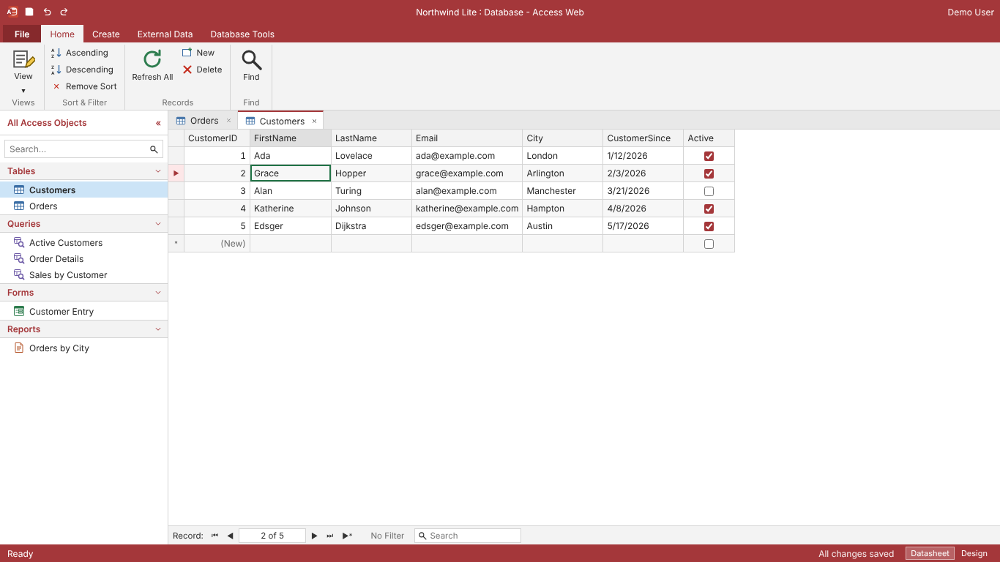

# Access Web

A browser-based look-alike of Microsoft Access. People register, build databases (tables, queries,
forms, reports, relationships), and everything saves to their account. Any database can be
downloaded as a real Microsoft Access **.accdb** file.



## What's in it

| Access feature | Here |
| --- | --- |
| Backstage / start screen | Templates (Blank, Contacts & Orders), My databases and Shared with me, rename, delete |
| Sharing | Share with registered users by email as **Can view** or **Can edit**, or let anyone with an account who has the link view or edit, or **publish** it so anyone with the link can view it without an account (no export or copy). Viewers can run queries, export, and **Save a copy**; other people's saves appear automatically within seconds |
| Ribbon | File, Home, Create, External Data, Database Tools, plus contextual *Table Design* / *Query Design* tabs |
| Navigation Pane | All Access Objects grouped by type, search, double-click to open, right-click Open / Design View / Copy / Paste / Rename / Delete, **F2 renames in place**, F11 to collapse |
| Copy & paste | **Ctrl+C / Ctrl+V** (or Home → Paste) copies tables, queries, forms and reports, within a database or into another one you open. Tables paste as *Structure Only*, *Structure and Data* or *Append Data to Existing Table*; pasted forms and reports reconnect to their record source by name |
| Tables — Datasheet View | Inline editing, keyboard navigation (arrows, Tab, Enter, F2, Esc), new-record row with `*`, record navigator, search filter, sort, multi-row delete, column widths (drag an edge, double-click to fit) saved with the table or query |
| Tables — Design View | Field Name / Data Type / Description grid, Field Properties pane (Field Size, Default Value, Required, Indexed), Primary Key, Insert/Delete Rows, safe type conversion |
| Data types | AutoNumber, Short Text, Long Text, Number (Byte/Integer/Long/Single/Double), Currency, Date/Time, Yes/No |
| Validation | Types, field sizes, primary keys, *No Duplicates* indexes, required-field reminders, referential integrity |
| Queries | **Select, Make Table, Append, Update, Delete and Crosstab** queries, chosen on the Query Design tab, each with Access's extra grid rows (Total, Crosstab, Append To, Update To, Delete). **Totals (Σ)** adds Group By, Sum, Avg, Min, Max, Count, StDev, Var, First, Last and Where. Design grid: Show Table (any time, to add more tables), double-click a field to add it (tap on touch screens), automatic joins from relationships drawn as join lines (1 and ∞ when enforced), drag a table's title bar to move it or its edges to resize it, drag the bar above the grid to resize the grid (the layout is saved with the query), select a column by its grey bar to drag, resize, Ctrl+←/→ or Delete it. SQL View for any of these, including SQL typed by hand or imported from Access. Datasheet View previews what an action query will change; **Run** applies it after a confirmation (Ctrl+Z undoes it), skipping and reporting records that would break keys, required fields or relationships, like Access. Select query results are **editable** when Access would allow it; drag a record selector's bottom edge or use **Row Height** (Home tab) to set the row height, which is saved with the query (tall rows wrap text) |
| Forms | **Form designer**: drag controls (label, text box, combo box, list box, check box or switch, button, rectangle, line) from the toolbox or fields from the field list onto the header, detail or footer; move, resize, align, size and layer them with snap-to-grid; edit everything in the Property Sheet (control source, label position, fonts, colours, borders, rounded corners, combo/list row sources from a value list, table or query, button actions such as next record, new, save, delete, open form/report, close). Seven themes (Office, Modern, Slate, Ocean, Forest, Sunset, Midnight), Stacked or Two Columns auto-layout, copy/paste/duplicate controls, every change undoable. Form View shows one record at a time with Enter moving to the next field; edits write back to the table; on phones the controls stack in one column |
| Reports | Grouped, sorted print layout with group and grand totals; Print |
| Relationships | Draggable table boxes, drag a field onto another to relate, Enforce Referential Integrity, 1–∞ lines |
| Other databases | External Data → **Import Objects** / **Link Objects**: pick one of your databases or one shared with you, then its tables and queries. *Import* copies them (definition and data, or definition only, plus relationships between them), renaming anything whose name is taken and updating imported queries to match. *Link* shows the source's current data read-only, for tables and select queries; links work in local queries too, and stop working (with a clear message) if the source is unshared or deleted |
| MySQL / MariaDB | External Data → **Connections**: server address (or a `mysql://` URL), port, database, user name, password and SSL, with **Test Connection**. **Test Connection** lists the server's databases to pick from. After saving, choose **Link Tables** (or **Link Tables…** in the Connections list) to see the database's tables; linked tables appear in the Navigation Pane and in Query Design's **Show Table**. **Link Tables** to browse remote tables (read-only, 500 records a page) and use them in local queries alongside your own tables; **Import Tables** copies tables, keys, indexes and foreign-key relationships with their data; **SQL Console** runs one statement at a time and shows `mysql`-client output (`Query OK…`, `ERROR 1146 (42S02)…`) plus a datasheet for SELECT results |
| External Data | **Import Access databases** (.accdb/.mdb), import CSV/text into a new table (type detection), export a table/query to CSV, **export the database to .accdb** |
| Phones & tablets | Detected automatically (screen size, touch input, and the browser's mobile hint). **Phones** get a phone layout: the ribbon collapses to its tab row and drops down when you tap a tab, the Navigation Pane becomes a slide-out drawer (☰), dialogs and menus fill the screen, forms stack in one column. **Touch screens** (phones and tablets) get taller rows, tap to open objects, tap a selected cell again to edit it, long-press for the object menu, tap-a-field-then-another to relate tables, and ◀ ✕ ▶ buttons to move query columns. File → **Layout** (or the start page) switches between Automatic, Phone and Desktop |
| Keyboard | Ctrl+; enters today's date and Ctrl+Shift+; the time (in Date/Time and text fields), double-click a combo box to cycle its choices, Ctrl+Z / Ctrl+Y undo and redo, Ctrl+S saves (it also autosaves) |

Queries accept Access SQL: `[Bracketed names]`, `"text"`, `#12/31/2026#` dates, `&` concatenation,
`Like "A*"` wildcards, `Yes`/`No`, and functions such as `IIf`, `Nz`, `Left`, `Right`, `Mid`, `Len`,
`UCase`, `LCase`, `Year`, `Month`, `Day`, `Now`, `Date`, `CStr`, `CInt`, `CDbl`, `Val`.

## Why this stack

The brief was "the most supportable code base", so every choice is a mainstream default with a
large hiring pool and long-term support:

- **TypeScript everywhere** for the app — **React 19 + Vite** in the browser, **Node.js 22 LTS + Express 5** on the
  server — so one team in one language owns the UI, the API and the shared data model (`shared/model.ts`, validated
  with **Zod** on both sides).
- **SQLite** (via `better-sqlite3`) stores users, sessions and projects. One file, zero administration, easy backups.
  `server/src/db.ts` is the only place that touches it, so moving to PostgreSQL later is a contained change.
- **SQLite compiled to WebAssembly** (`sql.js`) runs each user's queries **in their browser**. Untrusted SQL never
  executes on the server.
- **Jackcess (Java)** writes the `.accdb` file. It is the only mature, open-source library that can *create* Access
  databases; nothing comparable exists for Node, Python or .NET on Linux. It is isolated in a ~250-line command-line
  program (`exporter/`) that the server runs per export — no Java framework, no shared state.

## Running it

**Step-by-step guides:** [run it on your own PC](docs/INSTALL-LOCAL.md) (Windows, macOS, Linux desktop: a
local web server you open in your browser, no internet needed) and
[install it on a Linux server](docs/INSTALL-LINUX.md) (systemd service, nginx + HTTPS, backups).

### Docker (recommended)

```bash
docker compose up --build
# open http://localhost:3000
```

Data lives in the `access-web-data` volume (`/data/access-web.db`). Back it up by copying that file
(SQLite's `.backup` command is safest while running).

### Render.com

The repository includes a Render Blueprint (`render.yaml`). In Render: **New → Blueprint**, connect this GitHub
repository, and click **Apply**. Render builds the Dockerfile, attaches a 1 GB persistent disk at `/data` for the
SQLite database, serves the site over HTTPS, and redeploys on every push to the default branch.

A persistent disk needs a paid instance; on the free instance type the database would be erased on each deploy.
The disk also limits the service to one instance and means each deploy has a few seconds of downtime.

### Local development

Requires Node.js 22+, Java 21+ and Maven 3.9+.

```bash
npm install
npm run build:exporter     # builds exporter/target/access-exporter.jar
npm run dev                # API on :3001, web app with hot reload on http://localhost:5173
```

Production build without Docker:

```bash
npm run build && npm run build:exporter
NODE_ENV=production SECURE_COOKIES=false PORT=3000 npm start
```

### Configuration

| Variable | Default | Purpose |
| --- | --- | --- |
| `PORT` | `3001` (`3000` in Docker) | HTTP port |
| `DATA_DIR` | `./data` | Where `access-web.db` is stored |
| `SECURE_COOKIES` | `true` when `NODE_ENV=production` | Mark the session cookie Secure and add `upgrade-insecure-requests`. Set `false` only if you're not using HTTPS. |
| `TRUST_PROXY` | `false` | Set `true` behind a reverse proxy so client IPs (used for login rate limiting) are correct |
| `JAVA_BIN` | `java` | Java executable used for exports |
| `EXPORTER_JAR` | `exporter/target/access-exporter.jar` | Path to the exporter |
| `EXPORT_TIMEOUT_MS` | `60000` | Per-export time limit |
| `EXPORT_CONCURRENCY` | `2` | Exports that may run at once |
| `EXPORT_MAX_HEAP` | `512m` | Java heap per export; use `256m` on a 512 MB machine |
| `HOST` | all interfaces | Address to listen on; `127.0.0.1` accepts connections from this computer only (the local launchers and the Linux guide use it) |
| `STATIC_DIR` | `web/dist` | Built web app to serve |
| `CONNECTION_SECRET` | key file in `DATA_DIR` | Key that encrypts saved MySQL passwords (AES-256-GCM). If unset, a random key is created in `DATA_DIR/connection.key`. Changing it makes saved passwords unreadable (re-enter them) |
| `ALLOW_PRIVATE_DB_HOSTS` | `false` | Allow MySQL connections to private/internal addresses (localhost, 10.x, 192.168.x, cloud metadata). Leave off on a public server |

## Exporting to Access

**External Data → Access** (or **File → Export to Access**) downloads `<database>.accdb` in the Access 2016
format, which opens in Access 2007 and later.

Included: every table with its fields, data types, field sizes, descriptions, default values, Required, primary keys,
indexes, AutoNumber values (IDs are preserved), all data, and relationships including Enforce Referential Integrity.

Not included, because no open library can write them: saved query objects, forms and reports. Instead,
every saved query's SQL is written to a table named **`_SavedQueries`** — paste each into a new query in
Access's SQL View to recreate it. (The SQL you write here is Access SQL, so it usually works unchanged.)

Two safety nets keep exports from failing: a field marked *Required* that still has blank values is exported
without the Required flag, and a relationship whose data doesn't satisfy integrity is exported without
enforcement.

## Importing from Access

**Open Access database** on the home screen creates a new database from an `.accdb` or `.mdb` file (Access 97
and later). **External Data → Access** inside a database adds another file's tables and queries to it, renaming
anything whose name is already taken (Customers → Customers1). Imports can be undone with Ctrl+Z.

Imported: tables, data, field types and sizes, descriptions, default values, Required, primary keys, single-field
indexes, AutoNumber values, single-field relationships with referential integrity, and saved queries' SQL. Select
and union queries run as-is; action queries (append, update, delete, make-table) and crosstabs come across as SQL
you can read but not run yet. A database exported from this app round-trips completely, including its queries.

**Calculated fields** become a saved query named *<Table> with Calculated Fields* that returns every field of the
table plus each calculated field as an expression (one calculated field may use another). Use it in forms, reports
and other queries where you used the calculated fields. Its results are editable, and the calculated columns update
as soon as you change a field they use.

Not imported (each one is listed in the notes shown after the import): forms, reports, macros, modules, linked
tables, and Attachment, OLE Object and multi-value fields. Password-protected databases need the
password removed first (Access: File → Info → Decrypt Database). Uploads are limited to 100 MB and about
200,000 records.

## Sharing

The owner clicks **Share** (title bar, or File → Share) to add people by the email they registered with, as **Can view**
or **Can edit**, and to set general access: *Restricted*, or *Anyone with an account who has the link* can view or edit.
Shared databases appear under **Shared with me**. Only the owner can share, rename or delete; editors can change
everything inside the database; viewers see it read-only and can run queries, export it, or **Save a copy** of their own.
Removing a shared database from your list doesn't affect anyone else.

**Public viewing.** Ticking *Public: anyone on the internet with the link can view* lets people open the database's link
without an account (`GET /api/public/:id`). Public viewers browse tables and run queries, forms and reports, read-only.
Exporting (.accdb and text), copying objects, **Save a copy**, and importing or linking from it into another database are
turned off, and the server refuses those requests for anyone who only has public access. MySQL connection details and
linked tables aren't available to them. Anything shown on screen can still be copied by hand, so don't publish data you
wouldn't put on a public web page. Unticking it stops the link working for people without access straight away.

Several people can have a database open at once. Each workspace checks every few seconds for other people's saves and
loads them automatically when it has no unsaved changes of its own. If two people change it at the same moment, the
second save is refused with the other person's name and a **Reload latest** button — there's no live merging of
simultaneous edits yet.

## Security notes

- Passwords are hashed with scrypt (Node's built-in `crypto`); sessions are random 256-bit tokens stored as SHA-256
  hashes, in an `HttpOnly`, `SameSite=Lax` cookie that lasts 30 days.
- Every request checks the signed-in user's role on that database (owner, editor, viewer); databases you can't see
  return 404, so ids can't be probed. Only owners can share, rename or delete.
- CSRF: state-changing requests must be JSON or carry `X-Requested-With`, which cross-site forms can't send.
- Login and registration are rate-limited per IP; Helmet sets a strict Content Security Policy.
- Saves use optimistic concurrency (`revision`), so two open windows can't silently overwrite each other — the
  second one is told to reload.
- Users' SQL runs only in their own browser, against their own data.
- MySQL connections belong to a database. Passwords are encrypted at rest and never sent back to the browser; editors
  can use a connection (link, import, SQL Console), viewers can only browse linked tables. The SQL Console runs with
  the privileges of the MySQL account you saved, so give that account only the rights people should have.
- The server refuses MySQL connections to private and internal addresses unless `ALLOW_PRIVATE_DB_HOSTS=true`, so a
  public deployment can't be used to probe its own network. Your MySQL server must accept connections from the
  internet (ideally with SSL set to *Required* or *Verify*).

## Project layout

```
shared/        Data model + Zod schemas and templates, used by both server and web
server/        Express API: auth, projects, export (TypeScript)
  src/db.ts        SQLite connection and migrations
  src/auth.ts      Registration, login, sessions
  src/projects.ts  Project CRUD and the .accdb download
  src/export.ts    Converts a project to the exporter's JSON and runs Java
  src/accessImport.ts  Runs the Java tool in --import mode and converts the result (shared/exchange.ts)
  test/            API tests (Vitest + Supertest), including a real export read back with mdb-reader
web/           React app (TypeScript)
  src/engine/      Access-SQL translator, in-browser SQLite query runner, value parsing/formatting
  src/workspace/   Shell: ribbon, navigation pane, tabs, autosave, undo, CSV import
  src/views/       Datasheet, Table Design, Query Design/SQL, Reports, Relationships
  src/forms/       Form designer, Form View, form controls, themes and layouts
  test/            Query engine tests
exporter/      Java CLI using Jackcess: JSON on stdin -> .accdb, and --import .accdb/.mdb -> JSON
```

## Tests

```bash
npm test          # server API tests (needs Java + the built exporter for the export test) and web engine tests
npm run typecheck
```

## Extending

- **New field type:** add it to `FIELD_TYPES` in `shared/model.ts`, then handle it in `web/src/engine/values.ts`
  (parse/format), `web/src/engine/engine.ts` (`sqliteType`) and `AccessExporter.java` (`writeTable`/`convert`).
- **Database migrations:** append to `MIGRATIONS` in `server/src/db.ts`; never edit an entry that has shipped.
- **Changing the project document shape:** bump `version` in `projectDocSchema` and convert old documents when loading.

## Known limitations

- Parameter queries (PARAMETERS ...) and pass-through/data-definition queries don't run. The design grid's Field row
  picks table fields; calculated fields and expressions are typed in SQL View. New records can't be added through a
  select query's results, and records can be deleted through one only when it uses a single table. Delete queries
  don't cascade to related records.
- Linked tables (MySQL, or tables and queries from other databases here) are read-only. Links to other databases
  open only for people who can open the source database. Linked tables don't appear in the Show Table list of the query designer (use SQL View), aren't
  included in .accdb exports, and local queries read at most 10,000 rows from each. Use Import Tables for more.
- Reports are generated layouts (choose fields, order, grouping) rather than a free-form designer. Forms show one record at a time (no continuous forms or subforms yet), text boxes show fields rather than calculated expressions, and forms based on queries are read-only.
- No macros, VBA, attachments, lookup fields, or multi-value fields.
- Each database is stored as one JSON document; this is comfortable up to tens of thousands of records per database.
  Bigger datasets would call for storing rows in their own table.
